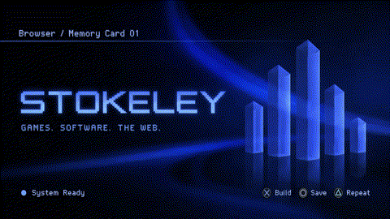

  

<b>Developer &amp; Designer</b> Games. Software. The web. Building worlds, one save at a time.

---

### Browser

Welcome to my corner of the internet. I'm **Stokeley**, a 24-year-old developer and designer from **Tashkent, Uzbekistan**, creating games, software, and websites. I enjoy shaping both how things work and how they feel — from a game's first screen to the small details of an interface.

### Memory Card · Projects

| Slot | Project | What it does |
| :--- | :--- | :--- |
| 01 | **[Void Hunter](https://github.com/StokeleyDev/Void-Hunter)** | Space bullet-heaven roguelite · browser & Telegram Web App |
| 02 | **[Questlio](https://github.com/StokeleyDev/Questlio)** | Windows game library & playtime tracker · Liquid Glass interface |
| 03 | **[Yangi lotin klaviatura](https://github.com/StokeleyDev/yangi-lotin-klaviatura)** | Windows keyboard & text converter for the new Uzbek alphabet |
| 04 | **[Win98 Skills Explorer](https://github.com/StokeleyDev/win98-skills-explorer)** | Retro desktop for browsing and editing Codex, Claude Code & Gemini skills |
| 05 | **[PTZ Desk](https://github.com/StokeleyDev/ptz-desk)** | Windows operator console for USB and ONVIF PTZ cameras, with camera and audio controls from a phone over LAN |

### Save Files · Downloads

- **[PTZ Desk · latest release](https://github.com/StokeleyDev/ptz-desk/releases/latest)** — Windows x64 installer and portable ZIP.
- **[Questlio · latest release](https://github.com/StokeleyDev/Questlio/releases/latest)** — Windows Setup with an uninstaller, or portable ZIP.
- **[Yangi lotin klaviatura · latest release](https://github.com/StokeleyDev/yangi-lotin-klaviatura/releases/latest)** — Windows installer and portable ZIP. Converts `sh → ş`, `ch → ç`, `o‘ → ö`, `g‘ → ğ`.
- **[Void Hunter · run locally](https://github.com/StokeleyDev/Void-Hunter#getting-started)** — game source and launch instructions.
- **[Win98 Skills Explorer · quick start](https://github.com/StokeleyDev/win98-skills-explorer#quick-start)** — runs locally with Python.

<a href="https://github.com/StokeleyDev?tab=repositories"><b>Browse all repositories</b></a>

### Currently Loading

**Crimson Survivors**  
My next game. More to share as development moves forward.

---

STOKELEY · MEMORY CARD INSERTED · MORE TO COME

