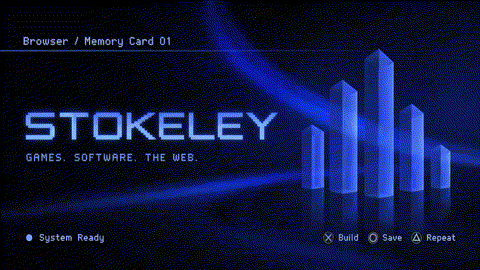

  

<b>Developer &amp; Designer</b> Games. Software. The web. Building worlds, one save at a time.

---

### Browser

Welcome to my corner of the internet. I'm **Stokeley**, a 24-year-old developer and designer from **Tashkent, Uzbekistan**, creating games, software, and websites. I enjoy shaping both how things work and how they feel — from a game's first screen to the small details of an interface.

### Memory Card · Projects

| Slot | Project | Status |
| :--- | :--- | :--- |
| 01 | **[Void Hunter](https://github.com/StokeleyDev/Void-Hunter)** | Current game |
| 02 | **Crimson Survivors** | In development |
| 03 | Another game | In development · title to be announced |
| 04 | **[Win98 Skills Explorer](https://github.com/StokeleyDev/win98-skills-explorer)** | Local AI skills manager |
| 05 | **[Questlio](https://github.com/StokeleyDev/Questlio)** | Game library & playtime tracker |
| 06–07 | Portfolio websites | In development |

<a href="https://github.com/StokeleyDev/Void-Hunter"><b>Explore Void Hunter</b></a> · <a href="https://github.com/StokeleyDev/Void-Hunter/releases">Releases</a>

### Currently Loading

**Crimson Survivors**  
My next game. More to share as development moves forward.

---

STOKELEY · MEMORY CARD INSERTED · MORE TO COME

